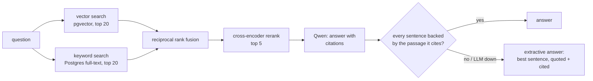

# hybrid-rag

[](https://github.com/amanuel1271/hybrid-rag/actions/workflows/ci.yml)


Question answering over internal docs with **hybrid search** (vector + keyword), **reranking**, and **answers that cite their sources and are checked claim by claim**. If an LLM answer can't be backed by the passages it cites, the API doesn't return it.

Everything runs locally: embeddings and the reranker are small ONNX models, the LLM is Qwen via Ollama, and the index is PostgreSQL. No API keys.



## Why hybrid: measured

35 hand-written questions over the 14-doc sample corpus in [`docs/`](docs) (a made-up logistics company). Half quote exact identifiers (`SHP-4031`, `orbit deploy rollback`), half are paraphrased ("someone pushed an API key to GitHub by accident"). `python eval.py`:

| mode | recall@1 | recall@5 | MRR |
|---|---|---|---|
| vector only | 0.83 | 0.91 | 0.85 |
| keyword only | 0.77 | 0.97 | 0.84 |
| hybrid (RRF) | 0.86 | **1.00** | 0.91 |
| hybrid + rerank | **0.91** | **1.00** | **0.95** |

Vector search misses exact codes (3 of 35); keyword search misses a paraphrase. The misses are different questions, so fusion finds all 35. The reranker then puts the right passage first more often. The test suite asserts each of those stages beats the one before it, so a change that breaks fusion or reranking fails CI.

The corpus and questions are small and written by me, so read these as relative gains, not absolute quality.

## Answer quality: measured

Each golden question lists the facts a correct answer must contain (e.g. "10 minutes", "LIMITS"); an answer is correct if it contains all of them. `python eval.py --llm` asks all 35 through `/ask`:

| answers | correct | falls back to extractive |
|---|---|---|
| extractive only (no LLM) | 0.77 | 100% |
| Qwen 2.5 3B, raw | 0.80 | – |
| **Qwen + claim-check guardrail** | **0.89** | 20% |

20% of Qwen's raw answers failed the claim check (uncited, unsupported, or wrong numbers) and were replaced by a quoted sentence, which turned 3 wrong answers into right ones. The 4 still wrong: the fallback quoting the wrong sentence twice (API-key leak, same-day cancellation), Qwen abstaining although the answer was retrieved (support raising quotas), and a canary question answered with the feature-flag rollout stages. Those are the next things to fix.

**CI gate:** `python eval.py --check` fails the build if any retrieval metric or extractive answer correctness drops below [`eval_baseline.json`](eval_baseline.json). Qwen metrics are checked locally (`--llm --check`), since CI has no LLM. Verified by breaking the extractive fallback: the gate exits 1 with `extractive.correct: 0.000 < baseline 0.770`.

## Latency: measured

Every pipeline stage is timed (`rag.timed`) into a Prometheus histogram, exported at `GET /metrics`, and `eval.py` prints p50/p95 from the same timings. Measured on a laptop (Apple M2 CPU, Docker), 35 golden questions through `/ask`:

| stage | p50 ms | p95 ms | note |
|---|---|---|---|
| embed (query) | 4.2 | 9.8 | bge-small, CPU |
| vector search (pgvector HNSW) | 0.5 | 1.9 | |
| keyword search (Postgres FTS) | 0.2 | 0.5 | |
| rerank (cross-encoder, up to 40 fused candidates) | 181 | 315 | the slowest non-LLM stage |
| LLM answer (Qwen 2.5 3B) | 1,530 | 3,255 | |
| claim check (similarity + contradiction) | 65 | 117 | was 46 / 91 before the NLI veto |
| **whole `/ask`, with LLM** | **1,796** | **3,621** | |
| whole `/ask`, extractive only | 235 | 487 | no LLM |

What it says: retrieval in Postgres is almost free (under 2 ms at p95). Without the LLM, the cross-encoder is about two-thirds of the request, so it's the first thing to batch, cap or move to a GPU. With the LLM, generation is about 85% of the time, which is why streaming matters more than any retrieval tuning.

## Streaming: show text early, keep the check

`POST /ask/stream` sends Server-Sent Events. The claim check needs the whole answer, so streamed text is a **draft**: the last event carries the checked answer, and if the draft fails the check, the UI swaps it for the extractive one.

```
event: sources   ->  retrieved passages, right after rerank
event: token     ->  {"text": "SHP-5003 is safe "}   (many)
event: final     ->  same body as /ask: answer, engine, verified, claims, sources
```

If the model dies mid-answer (timeout, error line, or the stream closes without Ollama's `done`), the draft is thrown away and `final` is the extractive answer. A cut-off sentence is never checked as if it were complete.

Same laptop, same 35 questions, measured at the client:

| event | p50 ms | p95 ms |
|---|---|---|
| sources | 208 | 441 |
| first token | 1,065 | 1,503 |
| final (checked answer) | 1,940 | 4,041 |

So the user sees sources at 0.2 s and words at about 1.1 s, instead of a blank screen for about 2 s. The first-token wait is mostly the 3B model reading the 5 passages on CPU. The cost: 7 of the 35 drafts failed the check and were replaced, so a UI should style streamed text as provisional until `final`. Time to first token is exported as `rag_stage_seconds{stage="first_token"}`.

Each `/ask` also writes one JSON log line (no question text, which may hold user data):

```json
{"event": "ask", "engine": "qwen", "verified": true, "llm_rejected": false, "passages": 5, "ms": 1712.4}
```

and increments `rag_answers_total{engine, verified}`, so the fallback rate can be graphed and alerted on.

## How the answer check works

| Rule | Enforced by |
|---|---|
| Every sentence must cite a passage that was actually retrieved | `[n]` parsed per sentence; out-of-range or missing citations fail |
| The cited passage must say what the sentence says | embedding similarity between the sentence and each sentence of the cited passage, threshold **0.70** |
| The cited passage must not contradict it | an entailment (NLI) model reads the cited sentences and the claim; contradiction probability above **0.5** fails it. Similarity alone can't see negation: "agents **cannot** approve refunds" scores 0.74 against "agents **can** approve refunds" |
| Numbers must be exact | every number in the claim must appear in the cited passage (embeddings treat "45 days" and "10 days" as near-identical) |
| A failed or empty LLM answer is never returned | the API falls back to the most relevant sentence from the top passages, quoted verbatim, and returns the rejected answer alongside it |
| "I don't know" is allowed | abstaining makes no claim, so it passes |

The 0.70 threshold came from real Qwen answers: correctly cited claims scored 0.77–1.00 (median 0.88), and the same claims against unrelated passages scored at most 0.67.

The contradiction check is a **veto, not a requirement**. On 29 real Qwen claims, contradiction scores were at most 0.07, while negated claims ("cannot", "must not") scored 0.99+. Requiring the model to say "entailed" instead would have rejected 10 of those 29 correct claims, because a small NLI model often calls a correct paraphrase "neutral". The model is [nli-deberta-v3-xsmall](https://huggingface.co/Xenova/nli-deberta-v3-xsmall) (ONNX, quantized), runs on the ONNX runtime fastembed already ships, and adds about 18 ms per answer (claim check p50 47 → 65 ms). Answer correctness on the eval is unchanged (0.89): no correct answer was rejected.

## Run it

```bash
ollama pull qwen2.5:3b            # optional: without Ollama, /ask uses the extractive fallback
docker compose up --build         # ingests docs/ on startup
curl 'localhost:8000/search?q=SHP-4031&k=3'
curl 'localhost:8000/search?q=who+gets+paged+if+I+miss+an+alert&mode=vector'
curl -X POST localhost:8000/ask -H 'content-type: application/json' \
  -d '{"question": "Is SHP-5003 safe to retry?"}'
curl -N -X POST localhost:8000/ask/stream -H 'content-type: application/json' \
  -d '{"question": "Is SHP-5003 safe to retry?"}'
```

```json
{
  "answer": "SHP-5003 is safe to retry with exponential backoff, starting at 1 second and capped at 30 seconds. [1]",
  "engine": "qwen",
  "verified": true,
  "claims": [{"sentence": "SHP-5003 is safe to retry ...", "citations": [1], "supported": true, "similarity": 0.884, "reason": null}],
  "rejected_llm_answer": null,
  "sources": [{"n": 1, "doc": "error-codes.md", "content": "Booking API Error Codes - SHP-5003: Carrier timeout ..."}]
}
```

Point it at your own docs with `DOCS_DIR` (one chunk per `##` section). Re-ingesting is idempotent: unchanged sections are skipped by content hash, and removed sections or files are deleted.

| Endpoint | Does |
|---|---|
| `GET /search?q=&mode=&k=` | `mode` = `vector`, `keyword`, `hybrid` or `rerank` (default) |
| `POST /ask` | `{"question": ...}` returns answer, engine (`qwen` or `extractive`), per-claim checks and sources |
| `POST /ask/stream` | same, as Server-Sent Events: `sources`, `token`s (draft), `final` (checked) |
| `GET /health` | chunk count |
| `GET /metrics` | Prometheus: `rag_stage_seconds{stage}` histograms, `rag_answers_total{engine,verified}` |

## Tests

```bash
docker compose up -d db
docker compose run --rm -v "$PWD":/app api pytest -q
```

39 tests: chunking, fusion, citation parsing (trailing, leading, dangling, `[1, 2]`, `[1-3]`, bullets), the claim checker, idempotent ingest, exact-code retrieval, the stage-by-stage eval, both answer engines, a hallucinated LLM answer being replaced, answer scoring, the regression gate, per-stage latency metrics (including a stage that raises), streaming (event order, a draft cut off mid-answer, a model stream that ends without `done`), and negated claims ("cannot", "must not") being rejected while a paraphrase passes. Each key check was mutation-tested: removing fusion, reranking, the number check, the similarity threshold or the contradiction veto makes a test fail.

## Trade-offs

- **Small local models.** `bge-small` and a MiniLM cross-encoder run on a laptop CPU in milliseconds, but a larger embedding model would raise the vector-only baseline. Qwen 2.5 3B sometimes abstains or cites oddly; that's what the checker and fallback are for. Set `OLLAMA_MODEL=qwen2.5:7b` for better answers.
- **Contradiction is vetoed, entailment isn't required.** The NLI model rejects claims the source contradicts ("must" vs "must not"), but an overclaim the source simply doesn't mention ("refunds of any size") is only caught if similarity drops. A larger NLI model could make "must be entailed" safe to require.
- **The extractive fallback quotes one sentence.** It picked the answering sentence for 27 of the 35 golden questions; answers that need two sentences come out partial.
- **Postgres full-text instead of BM25.** `ts_rank_cd` over an OR query is close enough here and keeps everything in one database; a dedicated BM25 index would rank long documents better.
- **Model calls run in a thread pool** so one slow `/ask` doesn't block other requests; under real load they belong in a separate worker with batching.

## Roadmap

Built one feature at a time, each with tests, eval numbers and green CI.

- [x] Hybrid retrieval, rerank, cited answers, claim checker, extractive guardrail
- [x] Answer-quality eval + CI regression gate
- [x] Observability: per-stage latency (p50/p95), Prometheus metrics, structured logs
- [x] Streaming answers (SSE), with the claim check still deciding the final answer
- [x] Entailment (NLI) contradiction veto for "must" vs "must not"
- [ ] Multi-hop questions: let the model search again (tool use)
- [ ] Document-level access control + prompt-injection guard for untrusted docs
- [ ] Semantic cache + PDF/HTML ingest
- [ ] Fine-tune the embedding model on the corpus and measure the lift
