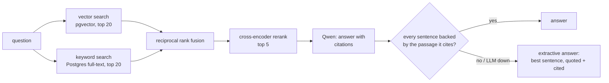

# hybrid-rag

[](https://github.com/amanuel1271/hybrid-rag/actions/workflows/ci.yml)


Question answering over internal docs with **hybrid search** (vector + keyword), **reranking**, and **answers that cite their sources and are checked claim by claim**. If an LLM answer can't be backed by the passages it cites, the API doesn't return it.

Everything runs locally: embeddings and the reranker are small ONNX models, the LLM is Qwen via Ollama, and the index is PostgreSQL. No API keys.



## Why hybrid: measured

35 hand-written questions over the 14-doc sample corpus in [`docs/`](docs) (a made-up logistics company). Half quote exact identifiers (`SHP-4031`, `orbit deploy rollback`), half are paraphrased ("someone pushed an API key to GitHub by accident"). `python eval.py`:

| mode | recall@1 | recall@5 | MRR |
|---|---|---|---|
| vector only | 0.83 | 0.91 | 0.85 |
| keyword only | 0.77 | 0.97 | 0.84 |
| hybrid (RRF) | 0.86 | **1.00** | 0.91 |
| hybrid + rerank | **0.91** | **1.00** | **0.95** |

Vector search misses exact codes (3 of 35); keyword search misses a paraphrase. The misses are different questions, so fusion finds all 35. The reranker then puts the right passage first more often. The test suite asserts each of those stages beats the one before it, so a change that breaks fusion or reranking fails CI.

The corpus and questions are small and written by me, so read these as relative gains, not absolute quality.

## Answer quality: measured

Each golden question lists the facts a correct answer must contain (e.g. "10 minutes", "LIMITS"); an answer is correct if it contains all of them. `python eval.py --llm` asks all 35 through `/ask`:

| answers | correct | falls back to extractive |
|---|---|---|
| extractive only (no LLM) | 0.77 | 100% |
| Qwen 2.5 3B, raw | 0.80 | – |
| **Qwen + claim-check guardrail** | **0.89** | 20% |

20% of Qwen's raw answers failed the claim check (uncited, unsupported, or wrong numbers) and were replaced by a quoted sentence, which turned 3 wrong answers into right ones. The 4 still wrong: the fallback quoting the wrong sentence twice (API-key leak, same-day cancellation), Qwen abstaining although the answer was retrieved (support raising quotas), and a canary question answered with the feature-flag rollout stages. Those are the next things to fix.

**CI gate:** `python eval.py --check` fails the build if any retrieval metric or extractive answer correctness drops below [`eval_baseline.json`](eval_baseline.json). Qwen metrics are checked locally (`--llm --check`), since CI has no LLM. Verified by breaking the extractive fallback: the gate exits 1 with `extractive.correct: 0.000 < baseline 0.770`.

## How the answer check works

| Rule | Enforced by |
|---|---|
| Every sentence must cite a passage that was actually retrieved | `[n]` parsed per sentence; out-of-range or missing citations fail |
| The cited passage must say what the sentence says | embedding similarity between the sentence and each sentence of the cited passage, threshold **0.70** |
| Numbers must be exact | every number in the claim must appear in the cited passage (embeddings treat "45 days" and "10 days" as near-identical) |
| A failed or empty LLM answer is never returned | the API falls back to the most relevant sentence from the top passages, quoted verbatim, and returns the rejected answer alongside it |
| "I don't know" is allowed | abstaining makes no claim, so it passes |

The 0.70 threshold came from real Qwen answers: correctly cited claims scored 0.77–1.00 (median 0.88), and the same claims against unrelated passages scored at most 0.67.

## Run it

```bash
ollama pull qwen2.5:3b            # optional: without Ollama, /ask uses the extractive fallback
docker compose up --build         # ingests docs/ on startup
curl 'localhost:8000/search?q=SHP-4031&k=3'
curl 'localhost:8000/search?q=who+gets+paged+if+I+miss+an+alert&mode=vector'
curl -X POST localhost:8000/ask -H 'content-type: application/json' \
  -d '{"question": "Is SHP-5003 safe to retry?"}'
```

```json
{
  "answer": "SHP-5003 is safe to retry with exponential backoff, starting at 1 second and capped at 30 seconds. [1]",
  "engine": "qwen",
  "verified": true,
  "claims": [{"sentence": "SHP-5003 is safe to retry ...", "citations": [1], "supported": true, "similarity": 0.884, "reason": null}],
  "rejected_llm_answer": null,
  "sources": [{"n": 1, "doc": "error-codes.md", "content": "Booking API Error Codes - SHP-5003: Carrier timeout ..."}]
}
```

Point it at your own docs with `DOCS_DIR` (one chunk per `##` section). Re-ingesting is idempotent: unchanged sections are skipped by content hash, and removed sections or files are deleted.

| Endpoint | Does |
|---|---|
| `GET /search?q=&mode=&k=` | `mode` = `vector`, `keyword`, `hybrid` or `rerank` (default) |
| `POST /ask` | `{"question": ...}` returns answer, engine (`qwen` or `extractive`), per-claim checks and sources |
| `GET /health` | chunk count |

## Tests

```bash
docker compose up -d db
docker compose run --rm -v "$PWD":/app api pytest -q
```

30 tests: chunking, fusion, citation parsing (trailing, leading, dangling, `[1, 2]`, `[1-3]`, bullets), the claim checker, idempotent ingest, exact-code retrieval, the stage-by-stage eval, both answer engines, a hallucinated LLM answer being replaced, answer scoring and the regression gate. Each key check was mutation-tested: removing fusion, reranking, the number check or the similarity threshold makes a test fail.

## Trade-offs

- **Small local models.** `bge-small` and a MiniLM cross-encoder run on a laptop CPU in milliseconds, but a larger embedding model would raise the vector-only baseline. Qwen 2.5 3B sometimes abstains or cites oddly; that's what the checker and fallback are for. Set `OLLAMA_MODEL=qwen2.5:7b` for better answers.
- **Similarity is not entailment.** The checker catches answers that drift from their source and wrong numbers, but not every subtle contradiction ("must" vs "must not"). An NLI model would be the next step.
- **The extractive fallback quotes one sentence.** It picked the answering sentence for 27 of the 35 golden questions; answers that need two sentences come out partial.
- **Postgres full-text instead of BM25.** `ts_rank_cd` over an OR query is close enough here and keeps everything in one database; a dedicated BM25 index would rank long documents better.
- **Model calls run in a thread pool** so one slow `/ask` doesn't block other requests; under real load they belong in a separate worker with batching.

## Roadmap

Built one feature at a time, each with tests, eval numbers and green CI.

- [x] Hybrid retrieval, rerank, cited answers, claim checker, extractive guardrail
- [x] Answer-quality eval + CI regression gate
- [ ] Observability: per-stage latency (p50/p95), Prometheus metrics, structured logs
- [ ] Streaming answers (SSE)
- [ ] Entailment (NLI) claim check for "must" vs "must not"
- [ ] Multi-hop questions: let the model search again (tool use)
- [ ] Document-level access control + prompt-injection guard for untrusted docs
- [ ] Semantic cache + PDF/HTML ingest
- [ ] Fine-tune the embedding model on the corpus and measure the lift
